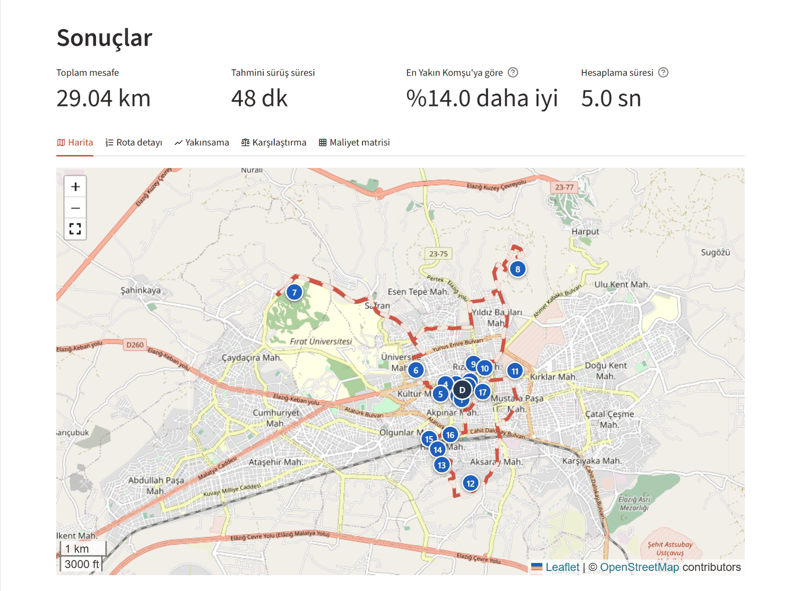
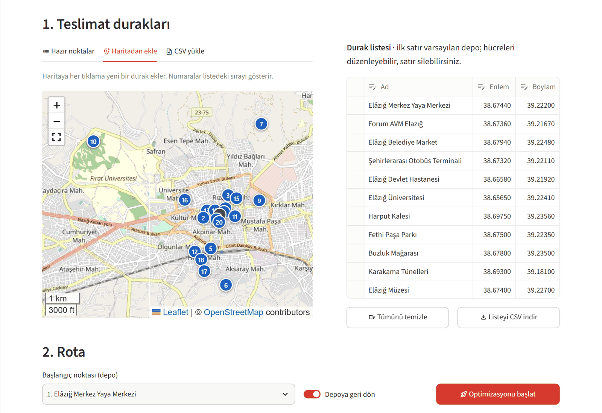
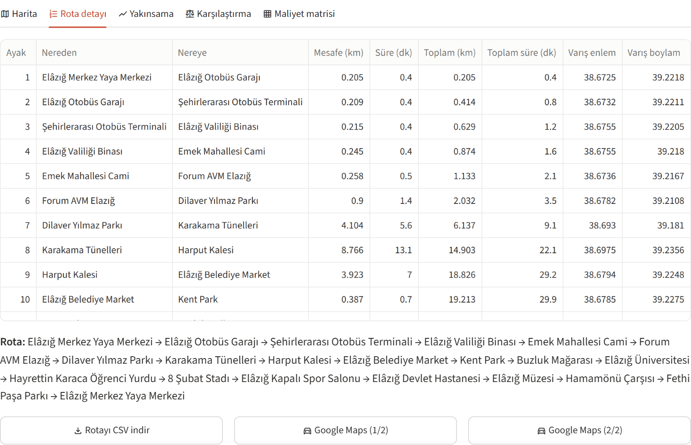
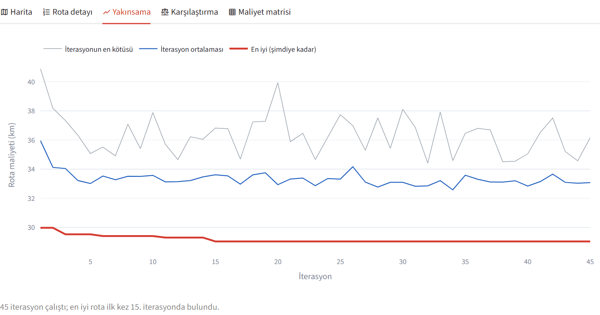
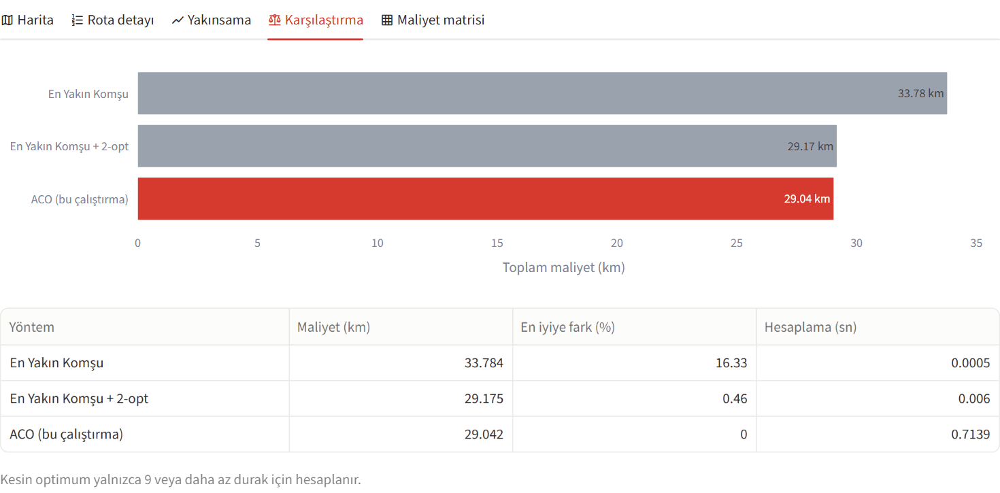
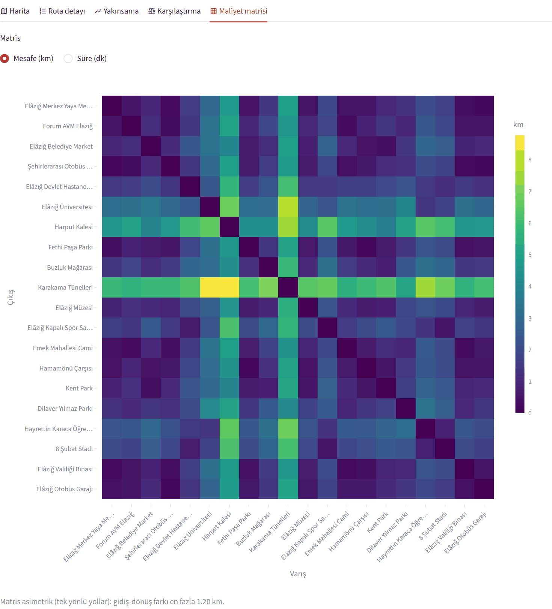
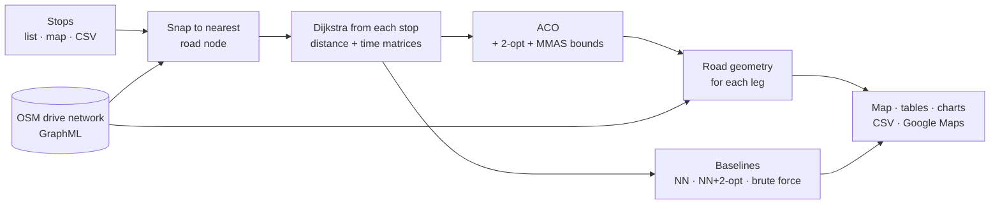

<div align="center">

# AntRoute

**Delivery route optimization on a real road network with Ant Colony Optimization**

[](https://github.com/aaas72/AntRoute/actions/workflows/tests.yml)


**English** · [Türkçe](README.tr.md)



</div>

AntRoute finds the shortest (or fastest) order in which a courier can visit a set of stops in **Elazığ, Türkiye**, and draws the result on the actual streets. Distances come from the OpenStreetMap drive network, one-way streets included, and the route is optimized with an improved **Ant Colony Optimization** algorithm. Every run is benchmarked against classic heuristics, and against the exact optimum when the problem is small enough.

## Contents

- [Features](#features)
- [Quick start](#quick-start)
- [Using the app](#using-the-app)
- [How it works](#how-it-works)
- [Results](#results)
- [Project structure](#project-structure)
- [Using the algorithm as a library](#using-the-algorithm-as-a-library)
- [Testing](#testing)
- [Roadmap](#roadmap)

## Features

| | |
|---|---|
| **Real, directed road costs** | Shortest paths on the OSM drive network respect one-way streets, so A→B and B→A can differ (by up to 1.2 km between the built-in Elazığ stops). |
| **Distance or time** | Optimize for kilometres or for driving minutes; travel times come from OSM speed limits, with road-type defaults where tags are missing. |
| **Routes on the actual streets** | Each leg is drawn with the real road geometry, not as a straight line. |
| **Improved ACO** | Fixed depot, closed tour or open path, elitist ant, MAX-MIN pheromone bounds, 2-opt local search, early stopping. |
| **Built-in benchmarks** | Every run is compared with Nearest Neighbour, Nearest Neighbour + 2-opt, and the brute-force optimum for ≤ 9 stops. |
| **Three ways to add stops** | Pick from 20 known Elazığ locations, click on the map, or upload a CSV, then edit everything in one table. |
| **Export** | Leg-by-leg CSV and one-click Google Maps directions (split automatically when a route exceeds Google's stop limit). |
| **Works without the network file** | Falls back to straight-line distance × 1.3 and offers to download the road network from the sidebar. |

## Quick start

Requires **Python 3.10+**.

```bash
git clone https://github.com/aaas72/AntRoute.git
cd AntRoute

python -m venv .venv
.venv\Scripts\activate            # Windows
# source .venv/bin/activate       # Linux / macOS

pip install -r requirements.txt
python src/generate_graphml.py    # one-time: downloads the Elazığ road network (~12 MB, 1-3 min)
python src/main.py                # opens http://localhost:8501
```

`generate_graphml.py` downloads a 9 km radius around the city centre by default. Use `--radius 12000` for a larger area or `--place "Merkez, Elazığ, Türkiye"` to download by place name. If the public Overpass server is busy, mirror servers are tried automatically.

## Using the app

The interface is in Turkish. A typical session has three steps.

### 1. Add delivery stops



- **Hazır noktalar (preset points):** a searchable list of 20 Elazığ locations.
- **Haritadan ekle (add from map):** every click on the map adds a stop.
- **CSV yükle (upload CSV):** columns `name, latitude, longitude`. Turkish names (`ad, enlem, boylam`) and the `;` separator also work, and a template is available for download.

All stops end up in the table on the right, where names and coordinates can be edited and rows deleted. Pick the **depot** (start point), choose whether the courier **returns to the depot**, then press **Optimizasyonu başlat** (start optimization).

### 2. Tune the algorithm (sidebar, optional)

| Setting | Meaning | Default |
|---|---|---|
| Gerçek yol ağı (OSM) | Use the real road network; off = straight-line × 1.3 | on |
| Optimizasyon kriteri | Optimize distance (km) or time (min) | distance |
| Karınca sayısı / Maks. iterasyon / Tohum | Ants per iteration / max iterations / random seed | 20 / 100 / 42 |
| Erken durdurma (sabır) | Stop after this many iterations without improvement | 30 |
| α, β, ρ, Q | Pheromone weight, distance weight, evaporation, deposit constant | 1, 3, 0.3, 100 |
| Elitist ağırlık | Extra pheromone on the best route so far | 1 |
| 2-opt yerel arama | Remove crossings from each iteration's best route | on |

### 3. Read the results

The summary shows total distance, estimated driving time, improvement over Nearest Neighbour, and either the gap to the exact optimum (≤ 9 stops) or the computation time. Five tabs hold the details:

<table>
<tr>
<td width="50%"><br><b>Rota detayı (route details):</b> leg-by-leg distance, time and running totals, plus CSV export and Google Maps links.</td>
<td width="50%"><br><b>Yakınsama (convergence):</b> best-so-far, iteration average and iteration worst route cost.</td>
</tr>
<tr>
<td><br><b>Karşılaştırma (comparison):</b> ACO against the baseline heuristics and the exact optimum, on the same cost matrix.</td>
<td><br><b>Maliyet matrisi (cost matrix):</b> distance or time between every pair of stops; its asymmetry shows the effect of one-way streets.</td>
</tr>
</table>

## How it works



### Cost matrix

1. **Snapping:** each stop is attached to its nearest road node. Stops more than 300 m from the road trigger a warning.
2. **Shortest paths:** one Dijkstra run per stop (`n` runs rather than `n²/2`) gives a full row of the matrix, both for `length` (km) and for `travel_time` (min).
3. **Directed costs:** the drive network contains one-way streets, so the matrix is **not** symmetric and is never forced to be.
4. **Unreachable pairs:** pairs with no path are marked `inf`. The algorithm replaces them with a large penalty and the UI reports them.

### Ant Colony Optimization

Each iteration, every ant builds a route starting at the depot. From stop *i* it picks the next unvisited stop *j* with probability

$$p_{ij} \propto \tau_{ij}^{\,\alpha}\cdot\left(\frac{1}{d_{ij}}\right)^{\beta}$$

where τ is the pheromone and *d* the cost. After all ants have finished:

1. **Local search:** the iteration's best route is improved with **2-opt**. On asymmetric matrices the reversed segment's internal edges are re-costed too.
2. **Evaporation:** τ ← (1 − ρ) · τ.
3. **Deposit:** each ant adds Q / L to the edges it used, and the best-so-far route adds an extra *e* · Q / L_best (elitist strategy). Deposits go in both directions only when the matrix is symmetric.
4. **MAX-MIN bounds:** τ is clipped to [τ_min, τ_max] ([Stützle & Hoos, 2000](https://doi.org/10.1016/S0167-739X(00)00043-1)). Without the bounds, pheromone collapses onto one route and the search stops exploring.

The run ends after the maximum number of iterations, or earlier once the best route has not improved for `patience` iterations.

## Results

20 built-in Elazığ stops, closed tour, real directed road distances, 20 ants, 100 iterations:

| Method | Total distance | Time |
|---|---:|---:|
| Nearest Neighbour | 33.78 km | < 1 ms |
| Nearest Neighbour + 2-opt | 29.18 km | ~ 5 ms |
| Previous ACO version* | 30.33 – 31.47 km | ~ 1.7 s |
| **AntRoute ACO** (3 seeds) | **28.90 – 29.06 km** | **~ 0.5 s** |

\* The previous version symmetrised the matrix, so it displayed 29.43 km. Its routes are 30.3 – 31.5 km once driven on the real one-way streets.

On random 8-stop problems the test suite checks that ACO hits the exact optimum in at least 90 % of cases and always lands within 2 % of it.

## Project structure

```
AntRoute/
├── src/
│   ├── main.py                  # launcher: python src/main.py
│   ├── generate_graphml.py      # downloads the road network (CLI)
│   ├── aco/
│   │   ├── algorithm.py         # ACO solver
│   │   ├── tsp.py               # nearest neighbour, 2-opt, brute force
│   │   └── utils.py             # haversine distance / matrix
│   ├── data/
│   │   ├── osm_data.py          # network download & load, snapping, matrices, leg geometry
│   │   └── location_data.py     # preset Elazığ stops, CSV reader
│   └── ui/
│       ├── app.py               # Streamlit app
│       ├── map_visualization.py # Folium maps
│       ├── plots.py             # Plotly charts
│       └── export.py            # route table, Google Maps links
├── tests/                       # pytest suite (48 tests)
├── docs/
│   ├── images/                  # screenshots used in this README
│   └── screenshots.py           # regenerates them with Playwright
└── .github/workflows/tests.yml  # CI
```

## Using the algorithm as a library

The solver is independent of the UI and accepts any square cost matrix:

```python
import numpy as np
from aco.algorithm import ACO          # run from src/, or add src/ to PYTHONPATH

dist = np.array([[0, 2, 9, 10],
                 [1, 0, 6, 4],
                 [15, 7, 0, 8],
                 [6, 3, 12, 0]], dtype=float)   # asymmetric costs are fine

aco = ACO(dist, ant_count=20, start=0, return_to_start=True, seed=42)
route, cost, history = aco.run(iterations=100, patience=30)
print(route, cost)   # [0, 2, 3, 1, 0] 21.0
```

`history` holds the best, average and worst cost of every iteration. `progress_callback=f(it, total, best)` reports progress while the solver runs.

## Testing

```bash
pip install -r requirements-dev.txt
pytest -q
```

| File | Covers |
|---|---|
| `tests/test_aco.py` | optimality on small problems, symmetric/asymmetric, open/closed routes, depot, unreachable edges, seed reproducibility, early stopping |
| `tests/test_io.py` | CSV parsing (aliases, `;`, duplicates, errors), Google Maps links, route table |
| `tests/test_osm.py` | matrices and leg geometry on the real network (skipped if the GraphML file is absent) |
| `tests/test_app.py` | end-to-end UI runs with `streamlit.testing` |

To regenerate the screenshots after a UI change:

```bash
pip install playwright && python -m playwright install chromium
python docs/screenshots.py
```

## Roadmap

- [x] Time-based optimization
- [x] Editing and deleting stops
- [ ] Time windows (VRPTW)
- [ ] Multiple vehicles with capacity (CVRP)
- [ ] Live traffic via OSRM / OpenRouteService
- [ ] Parallel ant construction

## License

[MIT](LICENSE) © Abdellah Sheikh

## Author

**Abdellah Sheikh** · [abdellahsheikh.dev](https://abdellahsheikh.dev) · [LinkedIn](https://www.linkedin.com/in/abdellahsheikh)

Map data © [OpenStreetMap](https://www.openstreetmap.org/copyright) contributors.
