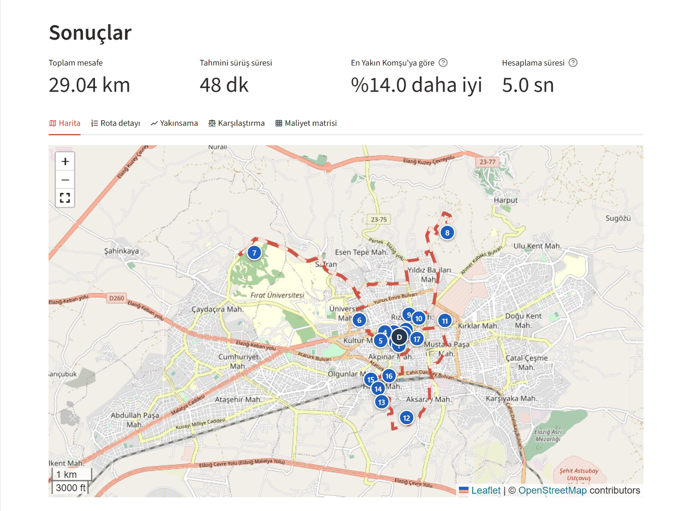
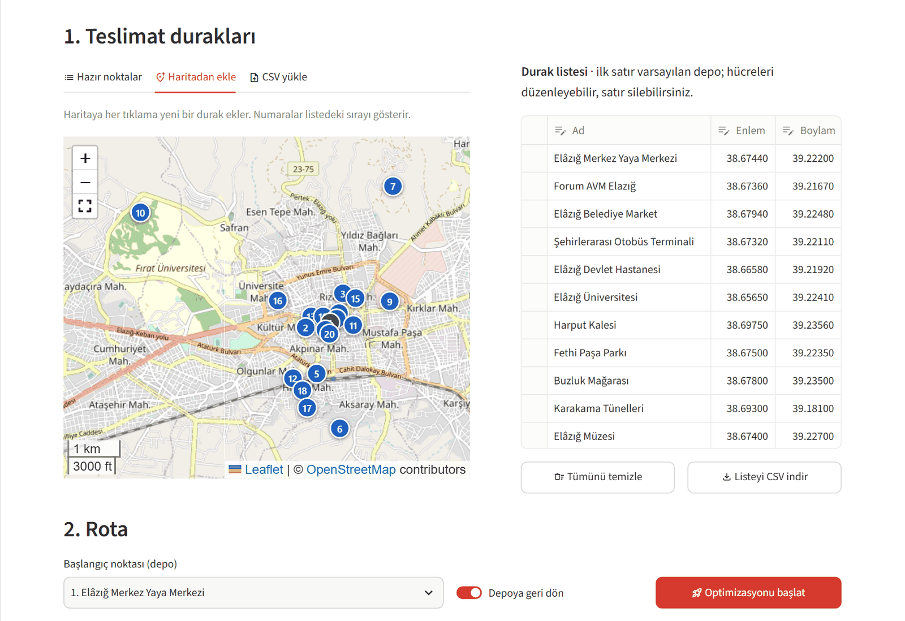
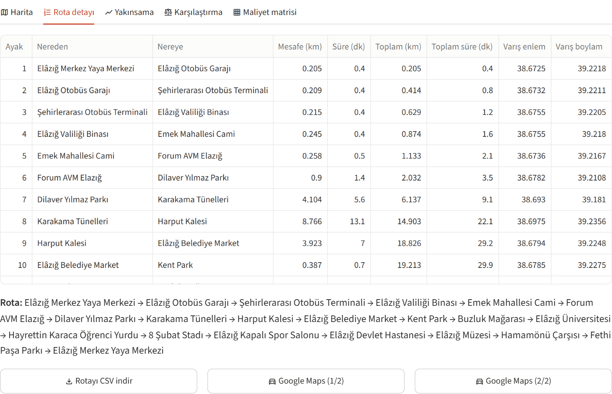
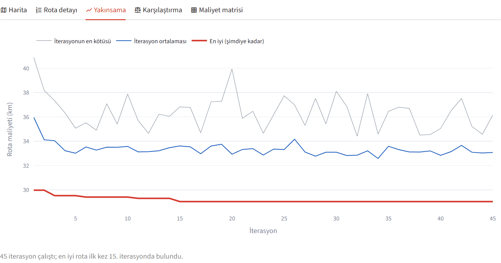
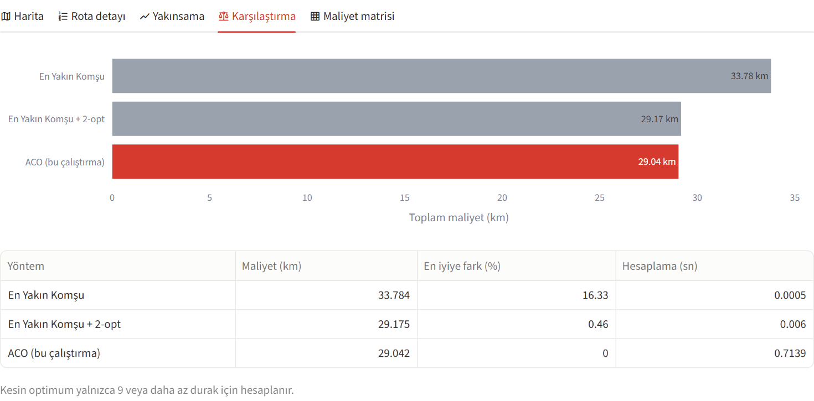
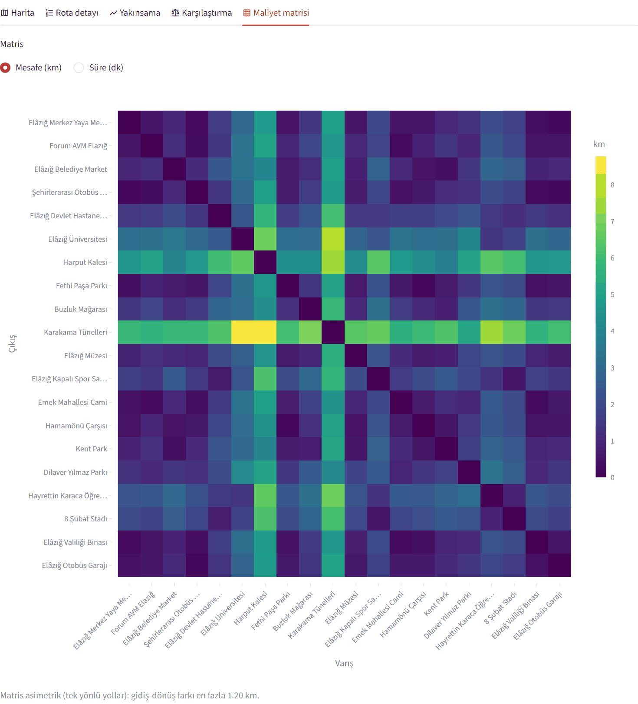
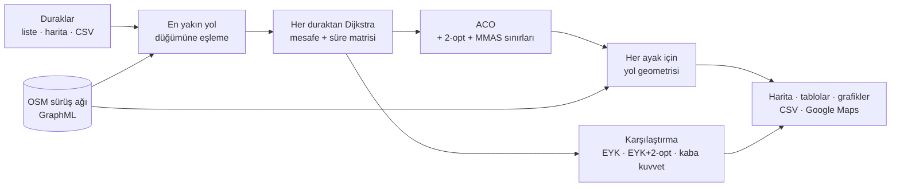

<div align="center">

# AntRoute

**Karınca Kolonisi Optimizasyonu ile gerçek yol ağı üzerinde teslimat rotası optimizasyonu**

[](https://github.com/aaas72/AntRoute/actions/workflows/tests.yml)


[English](README.md) · **Türkçe**



</div>

AntRoute, bir kuryenin **Elâzığ**'daki birden fazla durağı hangi sırayla ziyaret ederse en kısa (veya en hızlı) yolu kat edeceğini bulur ve sonucu gerçek sokaklar üzerinde çizer. Mesafeler OpenStreetMap sürüş ağından, tek yönlü yollar dahil olmak üzere hesaplanır. Rota, geliştirilmiş bir **Karınca Kolonisi Optimizasyonu (ACO)** algoritmasıyla optimize edilir. Her çalıştırma klasik sezgisel yöntemlerle, problem yeterince küçükse kesin optimumla da karşılaştırılır.

## İçindekiler

- [Özellikler](#özellikler)
- [Hızlı başlangıç](#hızlı-başlangıç)
- [Uygulamanın kullanımı](#uygulamanın-kullanımı)
- [Nasıl çalışır?](#nasıl-çalışır)
- [Sonuçlar](#sonuçlar)
- [Proje yapısı](#proje-yapısı)
- [Algoritmayı kütüphane olarak kullanma](#algoritmayı-kütüphane-olarak-kullanma)
- [Testler](#testler)
- [Yol haritası](#yol-haritası)

## Özellikler

| | |
|---|---|
| **Gerçek ve yönlü yol maliyetleri** | OSM sürüş ağındaki en kısa yollar tek yönlü sokakları dikkate alır; bu yüzden A→B ile B→A farklı olabilir (hazır Elâzığ duraklarında fark 1.2 km'ye kadar çıkar). |
| **Mesafe veya süre** | Kilometreye ya da sürüş dakikasına göre optimizasyon. Süreler OSM hız sınırlarından, etiket yoksa yol tipine göre varsayılan hızlardan hesaplanır. |
| **Gerçek sokaklar üzerinde rota** | Her ayak düz çizgi yerine gerçek yol geometrisiyle çizilir. |
| **Geliştirilmiş ACO** | Sabit depo, kapalı tur veya açık rota, elitist karınca, MAX-MIN feromon sınırları, 2-opt yerel arama, erken durdurma. |
| **Dahili karşılaştırma** | Her çalıştırma En Yakın Komşu, En Yakın Komşu + 2-opt ve ≤ 9 durak için kaba kuvvetle bulunan kesin optimumla karşılaştırılır. |
| **Durak eklemenin üç yolu** | 20 hazır Elâzığ noktasından seçim, haritaya tıklama veya CSV yükleme; hepsi tek bir tabloda düzenlenir. |
| **Dışa aktarım** | Ayak ayak CSV ve tek tıkla Google Maps yol tarifi (Google'ın durak sınırı aşılırsa rota otomatik bölünür). |
| **Yol ağı dosyası olmadan da çalışır** | Kuş uçuşu mesafe × 1.3 kullanır ve kenar çubuğundan yol ağını indirmeyi önerir. |

## Hızlı başlangıç

**Python 3.10+** gereklidir.

```bash
git clone https://github.com/aaas72/AntRoute.git
cd AntRoute

python -m venv .venv
.venv\Scripts\activate            # Windows
# source .venv/bin/activate       # Linux / macOS

pip install -r requirements.txt
python src/generate_graphml.py    # bir kez: Elâzığ yol ağını indirir (~12 MB, 1-3 dk)
python src/main.py                # http://localhost:8501 adresinde açılır
```

`generate_graphml.py` varsayılan olarak şehir merkezi etrafında 9 km yarıçaplı alanı indirir. Daha geniş alan için `--radius 12000`, yer adıyla indirmek için `--place "Merkez, Elazığ, Türkiye"` kullanılabilir. Genel Overpass sunucusu meşgulse yedek sunucular otomatik olarak denenir.

## Uygulamanın kullanımı

Tipik bir kullanım üç adımdan oluşur.

### 1. Teslimat duraklarını ekleyin



- **Hazır noktalar:** 20 Elâzığ noktasından oluşan, aranabilir liste.
- **Haritadan ekle:** haritaya her tıklama yeni bir durak ekler.
- **CSV yükle:** kolonlar `name, latitude, longitude`. Türkçe adlar (`ad, enlem, boylam`) ve `;` ayracı da kabul edilir; örnek şablon indirilebilir.

Tüm duraklar sağdaki tabloda toplanır; adlar ve koordinatlar düzenlenebilir, satırlar silinebilir. Ardından **depoyu** (başlangıç noktası) seçin, kuryenin **depoya geri dönüp dönmeyeceğini** belirleyin ve **Optimizasyonu başlat** düğmesine basın.

### 2. Algoritmayı ayarlayın (kenar çubuğu, isteğe bağlı)

| Ayar | Anlamı | Varsayılan |
|---|---|---|
| Gerçek yol ağı (OSM) | Kapalıysa kuş uçuşu × 1.3 | açık |
| Optimizasyon kriteri | Mesafe (km) veya süre (dk) | mesafe |
| Karınca sayısı / Maks. iterasyon / Tohum | İterasyon başına karınca / en fazla iterasyon / rastgele tohum | 20 / 100 / 42 |
| Erken durdurma (sabır) | Bu kadar iterasyon iyileşme olmazsa dur | 30 |
| α, β, ρ, Q | Feromon etkisi, mesafe etkisi, buharlaşma, feromon sabiti | 1, 3, 0.3, 100 |
| Elitist ağırlık | Şimdiye kadarki en iyi rotaya ekstra feromon | 1 |
| 2-opt yerel arama | Her iterasyonun en iyi rotasındaki kesişmeleri giderir | açık |

### 3. Sonuçları inceleyin

Özet satırında toplam mesafe, tahmini sürüş süresi, En Yakın Komşu'ya göre iyileşme ve kesin optimuma uzaklık (≤ 9 durak) ya da hesaplama süresi yer alır. Ayrıntılar beş sekmede sunulur:

<table>
<tr>
<td width="50%"><br><b>Rota detayı:</b> ayak ayak mesafe, süre ve kümülatif toplamlar; CSV indirme ve Google Maps bağlantıları.</td>
<td width="50%"><br><b>Yakınsama:</b> şimdiye kadarki en iyi, iterasyon ortalaması ve iterasyonun en kötü rota maliyeti.</td>
</tr>
<tr>
<td><br><b>Karşılaştırma:</b> aynı maliyet matrisi üzerinde ACO, temel sezgiseller ve kesin optimum.</td>
<td><br><b>Maliyet matrisi:</b> her durak çifti arasındaki mesafe veya süre; asimetri tek yönlü yolların etkisini gösterir.</td>
</tr>
</table>

## Nasıl çalışır?



### Maliyet matrisi

1. **Eşleme:** her durak en yakın yol düğümüne bağlanır. Yola 300 m'den uzak duraklar için uyarı verilir.
2. **En kısa yollar:** her durak için tek bir Dijkstra çalıştırması (`n²/2` yerine `n` çalıştırma) matrisin bütün satırını verir; hem `length` (km) hem `travel_time` (dk) için.
3. **Yönlü maliyetler:** sürüş ağı tek yönlü sokaklar içerdiğinden matris simetrik **değildir** ve simetrik olmaya zorlanmaz.
4. **Ulaşılamayan çiftler:** yolu olmayan çiftler `inf` olarak işaretlenir. Algoritma bunları büyük bir ceza değeriyle değiştirir, arayüz de kullanıcıyı uyarır.

### Karınca Kolonisi Optimizasyonu

Her iterasyonda her karınca depodan başlayarak bir rota oluşturur. *i* durağındaki karınca, ziyaret edilmemiş *j* durağını şu olasılıkla seçer:

$$p_{ij} \propto \tau_{ij}^{\,\alpha}\cdot\left(\frac{1}{d_{ij}}\right)^{\beta}$$

Burada τ feromonu, *d* maliyeti gösterir. Tüm karıncalar rotalarını tamamladıktan sonra:

1. **Yerel arama:** iterasyonun en iyi rotası **2-opt** ile iyileştirilir. Asimetrik matrislerde ters çevrilen parçanın iç kenarlarının maliyeti de yeniden hesaplanır.
2. **Buharlaşma:** τ ← (1 − ρ) · τ.
3. **Feromon bırakma:** her karınca kullandığı kenarlara Q / L, şimdiye kadarki en iyi rota ise ek olarak *e* · Q / L_best ekler (elitist strateji). Feromon iki yöne yalnızca matris simetrikse eklenir.
4. **MAX-MIN sınırları:** τ değerleri [τ_min, τ_max] aralığına kırpılır ([Stützle & Hoos, 2000](https://doi.org/10.1016/S0167-739X(00)00043-1)). Sınırlar olmadan feromon tek bir rotada toplanır ve arama keşfetmeyi bırakır.

Çalıştırma, maksimum iterasyon sayısına ulaşıldığında ya da en iyi rota `sabır` kadar iterasyon boyunca iyileşmediğinde sona erer.

## Sonuçlar

20 hazır Elâzığ durağı, kapalı tur, gerçek yönlü yol mesafeleri, 20 karınca, 100 iterasyon:

| Yöntem | Toplam mesafe | Süre |
|---|---:|---:|
| En Yakın Komşu | 33.78 km | < 1 ms |
| En Yakın Komşu + 2-opt | 29.18 km | ~ 5 ms |
| Önceki ACO sürümü* | 30.33 – 31.47 km | ~ 1.7 sn |
| **AntRoute ACO** (3 tohum) | **28.90 – 29.06 km** | **~ 0.5 sn** |

\* Önceki sürüm matrisi simetrik kabul ettiği için ekranda 29.43 km gösteriyordu. Bulduğu rotalar gerçek tek yönlü sokaklarda sürüldüğünde 30.3 – 31.5 km'dir.

Test paketi, rastgele 8 duraklı problemlerde ACO'nun durumların en az %90'ında kesin optimumu bulduğunu ve her zaman optimumun %2 yakınında kaldığını doğrular.

## Proje yapısı

```
AntRoute/
├── src/
│   ├── main.py                  # başlatıcı: python src/main.py
│   ├── generate_graphml.py      # yol ağını indirir (komut satırı)
│   ├── aco/
│   │   ├── algorithm.py         # ACO çözücü
│   │   ├── tsp.py               # en yakın komşu, 2-opt, kaba kuvvet
│   │   └── utils.py             # haversine mesafesi / matrisi
│   ├── data/
│   │   ├── osm_data.py          # ağ indirme/yükleme, eşleme, matrisler, ayak geometrisi
│   │   └── location_data.py     # hazır Elâzığ durakları, CSV okuyucu
│   └── ui/
│       ├── app.py               # Streamlit uygulaması
│       ├── map_visualization.py # Folium haritaları
│       ├── plots.py             # Plotly grafikleri
│       └── export.py            # rota tablosu, Google Maps bağlantıları
├── tests/                       # pytest paketi (48 test)
├── docs/
│   ├── images/                  # bu belgede kullanılan ekran görüntüleri
│   └── screenshots.py           # görüntüleri Playwright ile yeniden üretir
└── .github/workflows/tests.yml  # CI
```

## Algoritmayı kütüphane olarak kullanma

Çözücü arayüzden bağımsızdır ve herhangi bir kare maliyet matrisini kabul eder:

```python
import numpy as np
from aco.algorithm import ACO          # src/ içinden çalıştırın veya src/'yi PYTHONPATH'e ekleyin

dist = np.array([[0, 2, 9, 10],
                 [1, 0, 6, 4],
                 [15, 7, 0, 8],
                 [6, 3, 12, 0]], dtype=float)   # asimetrik maliyetler desteklenir

aco = ACO(dist, ant_count=20, start=0, return_to_start=True, seed=42)
route, cost, history = aco.run(iterations=100, patience=30)
print(route, cost)   # [0, 2, 3, 1, 0] 21.0
```

`history` her iterasyonun en iyi, ortalama ve en kötü maliyetini içerir. `progress_callback=f(it, total, best)` ile çözücü çalışırken ilerleme takip edilebilir.

## Testler

```bash
pip install -r requirements-dev.txt
pytest -q
```

| Dosya | Kapsam |
|---|---|
| `tests/test_aco.py` | küçük problemlerde optimallik, simetrik/asimetrik, açık/kapalı rota, depo, ulaşılamayan kenarlar, tohum tekrarlanabilirliği, erken durdurma |
| `tests/test_io.py` | CSV okuma (alternatif kolonlar, `;`, tekrar eden adlar, hatalar), Google Maps bağlantıları, rota tablosu |
| `tests/test_osm.py` | gerçek ağ üzerinde matrisler ve ayak geometrisi (GraphML dosyası yoksa atlanır) |
| `tests/test_app.py` | `streamlit.testing` ile uçtan uca arayüz testleri |

Arayüz değiştiğinde ekran görüntülerini yeniden üretmek için:

```bash
pip install playwright && python -m playwright install chromium
python docs/screenshots.py
```

## Yol haritası

- [x] Süreye dayalı optimizasyon
- [x] Durakları düzenleme ve silme
- [ ] Zaman pencereleri (VRPTW)
- [ ] Kapasiteli çoklu araç (CVRP)
- [ ] OSRM / OpenRouteService ile canlı trafik
- [ ] Paralel karınca rota oluşturma

## Lisans

[MIT](LICENSE) © Abdellah Sheikh

## Yazar

**Abdellah Sheikh** · [abdellahsheikh.dev](https://abdellahsheikh.dev) · [LinkedIn](https://www.linkedin.com/in/abdellahsheikh)

Harita verileri © [OpenStreetMap](https://www.openstreetmap.org/copyright) katkıda bulunanlar.
